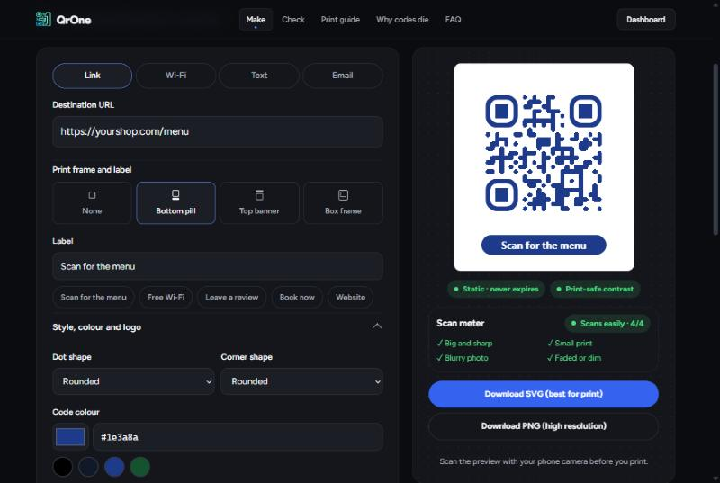
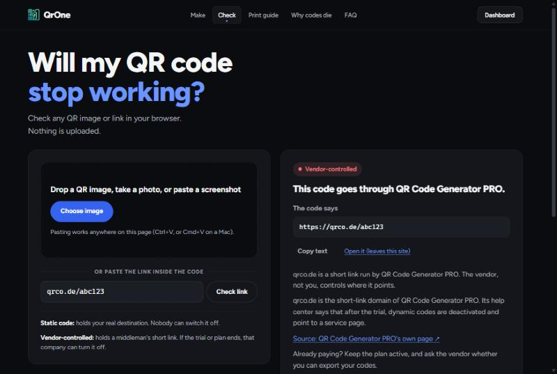
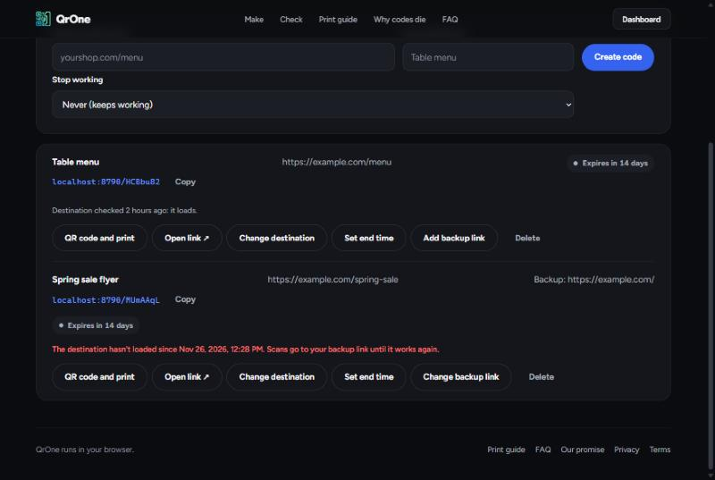
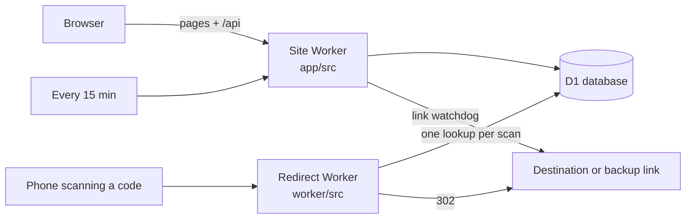

# QrOne

**QR codes that never die.** A free QR code studio with a live scan meter, a checker that tells you whether a printed code can be switched off, and editable codes that check their own destination every day. Everything runs on Cloudflare's free tier.

**Live demo:** https://qr-tool-site.qr-tool-spike.workers.dev



## What it does

**QR studio (home page): free, no account, nothing uploaded**
- Codes for links, Wi-Fi, text and email. Wi-Fi codes join the network when scanned.
- Dot shapes, corner shapes, colours, a logo in the middle, and print frames with a label ("Scan for the menu").
- **Scan meter:** reads your code back in the browser four ways (big and sharp, small print, blurry photo, faded print) and tells you if your styling went too far, with one tip to fix it.
- A contrast check, SVG and high-resolution PNG downloads, and printable sticker sheets for US Letter and A4.

**Checker (`/check`)**
- Drop in a photo or screenshot of a QR code, or paste the link inside it.
- It tells you whether the code holds your real address, or a vendor's short link that the vendor could switch off when a trial ends. Every vendor it names links to that vendor's own help or pricing page as the source.



**Editable codes (dashboard, needs sign-in)**
- Short links you can point somewhere else after printing, with optional end times.
- **Link watchdog:** every code's destination is checked about once a day. If it fails 3 checks in a row, scans go to a backup link until the page works again.
- Export every redirect as CSV, or as ready-to-use rules for Netlify, Apache, nginx or Cloudflare, so the codes can outlive this service.
- Sign in with Google, or with an emailed link once an email provider is set up.



> In the live demo, sign-in is limited to test accounts. Deploy your own copy (below) to use the dashboard.

## How it works



- **Front end:** Vite and plain JavaScript, no framework. QR drawing uses [qr-code-styling](https://github.com/kozakdenys/qr-code-styling) and reading uses [jsQR](https://github.com/cozmo/jsQR), both in the browser.
- **Site Worker** (`app/src`): serves the pages and the `/api` routes (sign-in, codes, export), and runs the watchdog on a cron.
- **Redirect Worker** (`worker/src`): does one database lookup per scan and answers with a 302, or a plain page if the code expired or ended. It records nothing about who scans.
- **Database:** Cloudflare D1 (SQLite). Migrations live in `worker/migrations`.
- **Security:** a strict Content-Security-Policy (no inline scripts or styles); single-use sign-in links stored only as hashes; `__Host-` session cookies; every destination checked before saving and again at scan time.

## Run it locally

You need Node 20+.

```bash
npm install
cp .dev.vars.example .dev.vars           # local settings; local sign-in shows the link on the page
npx wrangler d1 migrations apply qrone --local
npm run build
npx wrangler dev --port 8791             # the site: http://localhost:8791
```

In a second terminal, start the redirect Worker so short links work:

```bash
cd worker
npx wrangler dev --port 8790 --persist-to ../.wrangler/state
```

Only working on the free tools? `npm run dev` starts the front end alone at http://localhost:5173.

```bash
npm test        # the unit tests (Node's built-in test runner)
```

## Deploy your own

1. `npx wrangler login`
2. `npx wrangler d1 create qrone`, then put the new `database_id` in both `wrangler.jsonc` and `worker/wrangler.jsonc`.
3. `npx wrangler d1 migrations apply qrone --remote`
4. `cd worker && npx wrangler deploy`. Put the address it prints in `REDIRECT_ORIGIN` in `wrangler.jsonc`, and your site's address in `SITE_ORIGIN` in `worker/wrangler.jsonc`.
5. `npm run deploy`

**Sign-in.** Turn on at least one method:
- **Google:** create an OAuth client (type: Web application) with the redirect URI `https://<your-site>/api/auth/google/callback`. Put its client ID in `GOOGLE_CLIENT_ID` in `wrangler.jsonc`, then run `npx wrangler secret put GOOGLE_CLIENT_SECRET`.
- **Email links:** needs a domain verified with [Resend](https://resend.com) and a Cloudflare Turnstile widget. See the comments in `wrangler.jsonc`.

The code for one-time payments (Dodo Payments) is included but stays off unless you add its keys.

## Project layout

| Path | What's there |
|------|--------------|
| `index.html`, `check.html`, … | The pages (Vite multi-page) |
| `src/` | Front-end code: studio, scan meter, checker, dashboard |
| `app/src/` | Site Worker: API, sign-in, watchdog |
| `worker/` | Redirect Worker and database migrations |
| `tests/` | Unit tests |
| `docs/` | Design notes and screenshots |

## License

[AGPL-3.0](LICENSE)
